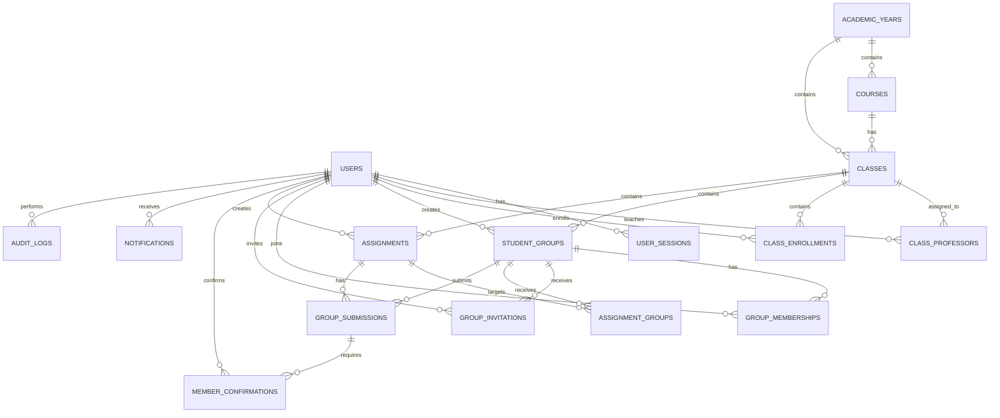

# Joineazy - System Architecture and Database Design

**Architecture style:** Modular monolith  
**Database:** PostgreSQL  
**Application type:** Web application

## 1. Architecture Overview

Joineazy should begin as a modular monolith rather than microservices.

The system has clear internal modules, but they run as one backend application and use one relational database. This keeps development, deployment, testing, and transaction management straightforward.

### Proposed technology stack

| Layer | Technology |
|---|---|
| Frontend | React + TypeScript |
| Styling | Tailwind CSS |
| Backend | Node.js + Express + TypeScript |
| Database | PostgreSQL |
| Database access | Prisma ORM or a comparable migration-capable ORM |
| Authentication | Secure cookie-based session or access/refresh token architecture |
| API | REST |
| Deployment | Docker |
| Testing | Jest, Supertest, Playwright |
| API documentation | OpenAPI / Swagger |

The stack is a proposed implementation baseline. Keep business logic independent of framework-specific code so components can be changed without redesigning the domain.

## 2. High-Level Architecture

```text
                 STUDENT / PROFESSOR / ADMIN
                             |
                             v
                       React Frontend
                             |
                       HTTPS / REST
                             |
                             v
                     Express Backend
                             |
       +---------------------+----------------------+
       |                     |                      |
       v                     v                      v
 Authentication        Academic Module         Group Module
       |                     |                      |
       v                     v                      v
  Session Service      Course/Class Service    Group Service
                             |                 Invitation Service
                             |                 Membership Service
                             |
       +---------------------+----------------------+
       |                     |                      |
       v                     v                      v
 Assignment Module     Submission Module       Notification Module
       |                     |                      |
       +---------------------+----------------------+
                             |
                             v
                       Audit Module
                             |
                             v
                       PostgreSQL
```

The backend should be divided into modules with clear ownership of their data and business rules.

## 3. Backend Modules

### 3.1 Authentication and Authorization

Responsibilities:

- Student registration.
- Login and logout.
- Password hashing and verification.
- Session management.
- Role-based authorization.
- Resource-level authorization.
- Account activation and deactivation.

Roles:

- `STUDENT`
- `PROFESSOR`
- `PLATFORM_ADMIN`

Do not rely on frontend role checks for security. Every protected operation must be authorized by the backend.

### 3.2 Academic Management

Responsibilities:

- Academic year management.
- Course management.
- Class creation and updates.
- Professor assignment.
- Student enrollment.
- Classroom access control.

A course can have multiple classes. Each class belongs to one course and one academic year.

A class is the primary scope for group formation and assignment management.

### 3.3 Group Management

Responsibilities:

- Group creation.
- Group lifecycle.
- Group invitations.
- Invitation acceptance and rejection.
- Membership history.
- Leadership management.
- Professor intervention.

Enforce the following business rules:

1. One group creation per student per class, permanently.
2. One active group membership per student per class.
3. One active leader per active group.
4. Invitation acceptance is required before membership becomes active.
5. Only enrolled students can participate in a class's groups.
6. Disbanded groups cannot receive new invitations or members.

### 3.4 Assignment Management

Responsibilities:

- Assignment creation and editing.
- Draft and publication workflow.
- Assignment targeting.
- Due dates.
- Assignment-group mapping.
- Assignment visibility.

### 3.5 Submission Management

Responsibilities:

- Group submission records.
- Submission timestamps.
- Individual member confirmation.
- Confirmation status.
- Professor waivers.
- Submission history.

A group submission and an individual confirmation are separate records.

### 3.6 Notification Management

Responsibilities:

- Create in-app notifications.
- Track read and unread states.
- Notify users about invitations, assignments, membership changes, and confirmations.

Notification delivery should not be allowed to break the main academic transaction. Create the notification record in the same transaction where appropriate, or use a reliable outbox mechanism if asynchronous delivery is introduced.

### 3.7 Audit Management

Record important actions, including:

- Account provisioning and deactivation.
- Class enrollment changes.
- Group creation and disbanding.
- Invitation decisions.
- Membership changes.
- Leadership transfers.
- Professor interventions.
- Assignment publication and targeting changes.
- Submission confirmation and waivers.

Audit records should be append-only for ordinary application users.

## 4. Entity Relationship Design

### 4.1 ER Diagram



## 5. Database Schema

Use UUID primary keys for application entities. Use UTC timestamps for stored dates and convert them to the user's local timezone in the frontend.

### 5.1 `users`

Stores all platform accounts.

| Column | Type | Constraints |
|---|---|---|
| id | UUID | Primary key |
| full_name | VARCHAR(150) | Not null |
| email | VARCHAR(255) | Unique, not null |
| password_hash | TEXT | Not null |
| role | ENUM | STUDENT / PROFESSOR / PLATFORM_ADMIN |
| status | ENUM | ACTIVE / INACTIVE / SUSPENDED |
| created_at | TIMESTAMPTZ | Not null |
| updated_at | TIMESTAMPTZ | Not null |

Use a normalized email value for uniqueness and lookup.

### 5.2 `user_sessions`

Stores authenticated sessions.

| Column | Type | Constraints |
|---|---|---|
| id | UUID | Primary key |
| user_id | UUID | FK to users |
| refresh_token_hash | TEXT | Unique |
| expires_at | TIMESTAMPTZ | Not null |
| revoked_at | TIMESTAMPTZ | Nullable |
| created_at | TIMESTAMPTZ | Not null |

Never store raw refresh tokens.

### 5.3 `academic_years`

| Column | Type | Constraints |
|---|---|---|
| id | UUID | Primary key |
| name | VARCHAR(30) | Not null |
| start_date | DATE | Not null |
| end_date | DATE | Not null |
| status | ENUM | ACTIVE / ARCHIVED |

Constraint: `end_date` must be after `start_date`.

### 5.4 `courses`

| Column | Type | Constraints |
|---|---|---|
| id | UUID | Primary key |
| name | VARCHAR(150) | Not null |
| code | VARCHAR(50) | Unique |
| description | TEXT | Nullable |
| created_at | TIMESTAMPTZ | Not null |

Examples: Computer Engineering, Information Technology.

### 5.5 `classes`

A class represents a specific Google Classroom-style classroom.

| Column | Type | Constraints |
|---|---|---|
| id | UUID | Primary key |
| course_id | UUID | FK to courses |
| academic_year_id | UUID | FK to academic_years |
| name | VARCHAR(150) | Not null |
| section | VARCHAR(50) | Nullable |
| join_code | VARCHAR(32) | Unique |
| status | ENUM | ACTIVE / ARCHIVED |
| created_at | TIMESTAMPTZ | Not null |
| updated_at | TIMESTAMPTZ | Not null |

Example: Data Structures - TY-B.

### 5.6 `class_professors`

Supports professor assignment to classrooms.

| Column | Type | Constraints |
|---|---|---|
| id | UUID | Primary key |
| class_id | UUID | FK to classes |
| professor_id | UUID | FK to users |
| assigned_at | TIMESTAMPTZ | Not null |
| assigned_by | UUID | FK to users |

Unique constraint: `(class_id, professor_id)`.

The backend must verify that `professor_id` belongs to a professor account.

### 5.7 `class_enrollments`

Tracks student enrollment in classrooms.

| Column | Type | Constraints |
|---|---|---|
| id | UUID | Primary key |
| class_id | UUID | FK to classes |
| student_id | UUID | FK to users |
| status | ENUM | ACTIVE / REMOVED |
| enrolled_at | TIMESTAMPTZ | Not null |
| removed_at | TIMESTAMPTZ | Nullable |

Maintain enrollment history. Enforce at most one active enrollment per student and class using a partial unique index.

### 5.8 `student_groups`

| Column | Type | Constraints |
|---|---|---|
| id | UUID | Primary key |
| class_id | UUID | FK to classes |
| name | VARCHAR(100) | Not null |
| description | TEXT | Nullable |
| created_by | UUID | FK to users |
| status | ENUM | ACTIVE / DISBANDED / ARCHIVED |
| max_members | INTEGER | Nullable |
| created_at | TIMESTAMPTZ | Not null |
| updated_at | TIMESTAMPTZ | Not null |

Critical constraint:

```sql
CREATE UNIQUE INDEX uq_group_creator_per_class
ON student_groups(class_id, created_by);
```

This permanently enforces one group creation per student per class, including after the group is disbanded.

Do not delete a group to reset this restriction.

### 5.9 `group_memberships`

Stores current and historical membership.

| Column | Type | Constraints |
|---|---|---|
| id | UUID | Primary key |
| group_id | UUID | FK to student_groups |
| student_id | UUID | FK to users |
| membership_role | ENUM | LEADER / MEMBER |
| joined_at | TIMESTAMPTZ | Not null |
| left_at | TIMESTAMPTZ | Nullable |
| left_reason | TEXT | Nullable |

Only one active membership per student per class is allowed. Because the class is determined through the group, enforce this with a database trigger or a transaction-safe membership operation that checks all groups in the class under appropriate locking. A partial unique index on `(student_id, class_id)` cannot be created directly because `class_id` is in another table.

A recommended stronger design is to store `class_id` on this table as a denormalized, constrained key and enforce consistency through a composite foreign key:

```sql
ALTER TABLE student_groups
ADD CONSTRAINT uq_group_id_class UNIQUE (id, class_id);

ALTER TABLE group_memberships
ADD COLUMN class_id UUID NOT NULL;

ALTER TABLE group_memberships
ADD CONSTRAINT fk_membership_group_class
FOREIGN KEY (group_id, class_id)
REFERENCES student_groups(id, class_id);

CREATE UNIQUE INDEX uq_active_membership_per_class
ON group_memberships(student_id, class_id)
WHERE left_at IS NULL;
```

The backend must also validate that the student is enrolled in the corresponding class.

For leadership, enforce one active leader per group:

```sql
CREATE UNIQUE INDEX uq_active_group_leader
ON group_memberships(group_id)
WHERE left_at IS NULL AND membership_role = 'LEADER';
```

A transaction must ensure that every active group has a leader.

### 5.10 `group_invitations`

| Column | Type | Constraints |
|---|---|---|
| id | UUID | Primary key |
| group_id | UUID | FK to student_groups |
| invited_student_id | UUID | FK to users |
| invited_by | UUID | FK to users |
| status | ENUM | PENDING / ACCEPTED / REJECTED / CANCELLED / EXPIRED |
| created_at | TIMESTAMPTZ | Not null |
| responded_at | TIMESTAMPTZ | Nullable |
| expires_at | TIMESTAMPTZ | Nullable |

Prevent duplicate pending invitations for the same student and group.

Acceptance must run in a transaction and recheck:

- The invitation is still pending.
- The group is active.
- The student is still enrolled.
- The student does not already have an active group in the class.
- The group has available capacity.
- The student account is active.

### 5.11 `assignments`

| Column | Type | Constraints |
|---|---|---|
| id | UUID | Primary key |
| class_id | UUID | FK to classes |
| created_by | UUID | FK to users |
| title | VARCHAR(200) | Not null |
| description | TEXT | Nullable |
| instructions | TEXT | Nullable |
| target_mode | ENUM | ALL_GROUPS / SELECTED_GROUPS |
| status | ENUM | DRAFT / PUBLISHED / CLOSED / ARCHIVED |
| published_at | TIMESTAMPTZ | Nullable |
| due_at | TIMESTAMPTZ | Nullable |
| created_at | TIMESTAMPTZ | Not null |
| updated_at | TIMESTAMPTZ | Not null |

### 5.12 `assignment_groups`

Stores the groups targeted by an assignment.

| Column | Type | Constraints |
|---|---|---|
| id | UUID | Primary key |
| assignment_id | UUID | FK to assignments |
| group_id | UUID | FK to student_groups |
| targeted_at | TIMESTAMPTZ | Not null |

Unique constraint: `(assignment_id, group_id)`.

Use this table as a snapshot of the groups targeted when the assignment is published. For `ALL_GROUPS`, populate it with all eligible groups in the class during publication. This avoids silently changing an existing assignment's scope when new groups are created later.

### 5.13 `group_submissions`

Stores one group's submission record for one assignment.

| Column | Type | Constraints |
|---|---|---|
| id | UUID | Primary key |
| assignment_id | UUID | FK to assignments |
| group_id | UUID | FK to student_groups |
| submitted_by | UUID | FK to users |
| submitted_at | TIMESTAMPTZ | Not null |
| submission_reference | TEXT | Nullable |
| notes | TEXT | Nullable |

Unique constraint: `(assignment_id, group_id)` if only one submission record is allowed.

If resubmissions are required later, replace this with a submission version model rather than overwriting historical records.

### 5.14 `member_confirmations`

Tracks individual confirmation for each eligible group member.

| Column | Type | Constraints |
|---|---|---|
| id | UUID | Primary key |
| group_submission_id | UUID | FK to group_submissions |
| student_id | UUID | FK to users |
| status | ENUM | PENDING / CONFIRMED / WAIVED |
| confirmed_at | TIMESTAMPTZ | Nullable |
| waived_by | UUID | FK to users, nullable |
| waiver_reason | TEXT | Nullable |
| created_at | TIMESTAMPTZ | Not null |

Unique constraint: `(group_submission_id, student_id)`.

Create confirmation records for all eligible members when the submission is recorded. This preserves the expected participant list even if group membership changes later.

### 5.15 `notifications`

| Column | Type | Constraints |
|---|---|---|
| id | UUID | Primary key |
| user_id | UUID | FK to users |
| type | VARCHAR(60) | Not null |
| title | VARCHAR(200) | Not null |
| message | TEXT | Not null |
| reference_type | VARCHAR(60) | Nullable |
| reference_id | UUID | Nullable |
| read_at | TIMESTAMPTZ | Nullable |
| created_at | TIMESTAMPTZ | Not null |

### 5.16 `audit_logs`

| Column | Type | Constraints |
|---|---|---|
| id | UUID | Primary key |
| actor_id | UUID | FK to users |
| action | VARCHAR(100) | Not null |
| entity_type | VARCHAR(80) | Not null |
| entity_id | UUID | Not null |
| reason | TEXT | Nullable |
| old_values | JSONB | Nullable |
| new_values | JSONB | Nullable |
| created_at | TIMESTAMPTZ | Not null |

Do not store passwords, tokens, or sensitive authentication secrets in audit records.

## 6. Critical Database Constraints

The following rules must be enforced beyond frontend validation:

| Rule | Enforcement |
|---|---|
| One group creation per student per class | Unique `(class_id, created_by)` |
| One active membership per student per class | Partial unique index on `(student_id, class_id)` |
| One active leader per group | Partial unique index on `group_id` |
| One invitation per student/group while pending | Partial unique index |
| One assignment target mapping per group | Unique `(assignment_id, group_id)` |
| One confirmation per submission/member | Unique `(group_submission_id, student_id)` |
| Valid membership and group class relationship | Composite foreign key |
| Valid date ranges | Check constraints |
| Valid role for professor assignment | Backend validation and controlled data operations |

All database migrations must be version-controlled.

## 7. Important Transactions

### Group creation

1. Verify student enrollment.
2. Insert group.
3. Insert creator membership with `LEADER` role.
4. Record audit event.
5. Commit.

The unique group creator constraint must prevent duplicate creation even if two requests arrive simultaneously.

### Invitation acceptance

1. Lock the invitation and relevant group record.
2. Verify invitation status.
3. Verify student enrollment and account status.
4. Verify no active group membership exists for the student in that class.
5. Verify group capacity.
6. Insert membership.
7. Update invitation status.
8. Record audit event.
9. Commit.

### Leadership transfer

1. Verify professor authority or current leader authority.
2. Verify the new leader is an active member.
3. Update old leader role.
4. Update new leader role.
5. Record audit event.
6. Commit.

Do not allow a partially completed leadership transfer.

### Assignment publication

1. Verify professor access to the class.
2. Validate assignment fields and due date.
3. Resolve eligible groups.
4. Insert assignment-group mappings.
5. Change status to `PUBLISHED`.
6. Record audit event.
7. Create notifications.
8. Commit.

### Group submission

1. Verify assignment targeting.
2. Verify the submitting student is an eligible member of the group.
3. Insert the group submission record.
4. Snapshot eligible members.
5. Insert one pending confirmation per eligible member.
6. Record audit event.
7. Create notifications.
8. Commit.

### Individual confirmation

1. Verify the student is the owner of the confirmation record.
2. Verify the confirmation is pending.
3. Change it to `CONFIRMED`.
4. Set the confirmation timestamp.
5. Commit.

A student must never be able to confirm another student's participation.

## 8. API Design

Use REST endpoints with consistent response structures and validation.

### Authentication

```text
POST   /api/auth/register
POST   /api/auth/login
POST   /api/auth/logout
POST   /api/auth/refresh
GET    /api/auth/me
```

### Academic structure

```text
GET    /api/courses
POST   /api/courses
GET    /api/classes
POST   /api/classes
GET    /api/classes/:classId
PATCH  /api/classes/:classId
POST   /api/classes/:classId/enrollments
DELETE /api/classes/:classId/enrollments/:studentId
```

### Groups

```text
GET    /api/classes/:classId/groups
POST   /api/classes/:classId/groups
GET    /api/groups/:groupId
PATCH  /api/groups/:groupId
POST   /api/groups/:groupId/invitations
GET    /api/groups/:groupId/invitations
POST   /api/invitations/:invitationId/accept
POST   /api/invitations/:invitationId/reject
POST   /api/groups/:groupId/leave
POST   /api/groups/:groupId/leadership-transfer
POST   /api/groups/:groupId/disband
```

### Assignments

```text
GET    /api/classes/:classId/assignments
POST   /api/classes/:classId/assignments
GET    /api/assignments/:assignmentId
PATCH  /api/assignments/:assignmentId
POST   /api/assignments/:assignmentId/publish
POST   /api/assignments/:assignmentId/close
```

### Submissions

```text
POST   /api/assignments/:assignmentId/groups/:groupId/submissions
GET    /api/assignments/:assignmentId/submissions
GET    /api/submissions/:submissionId
POST   /api/confirmations/:confirmationId/confirm
POST   /api/confirmations/:confirmationId/waive
```

### Administration

```text
GET    /api/admin/users
POST   /api/admin/professors
PATCH  /api/admin/users/:userId/status
GET    /api/admin/audit-logs
```

Use appropriate HTTP status codes, structured error codes, and pagination.

## 9. Authorization Model

Use role-based access control together with resource-level authorization.

Examples:

- A student can view only classes in which they are enrolled.
- A student can view only groups and assignments accessible within their classes.
- A student can accept only invitations addressed to them.
- A professor can manage only assigned classrooms.
- A professor can intervene only in groups belonging to an authorized classroom.
- A platform administrator can manage platform-level records.
- A student cannot call professor or administrator endpoints by changing frontend requests.

The backend must verify the relationship between the current user and the requested resource.

## 10. Security Requirements

- Hash passwords with Argon2id.
- Use HTTPS in production.
- Use Secure, HttpOnly cookies for session credentials where cookie-based authentication is used.
- Apply CSRF protection when authentication uses cookies.
- Rotate and revoke refresh tokens or sessions.
- Validate all input with a schema validation library.
- Use parameterized database operations.
- Apply rate limits to login, registration, invitations, and sensitive operations.
- Configure CORS with explicit allowed origins.
- Use secure headers.
- Keep secrets in environment variables or a secrets manager.
- Do not expose internal errors or stack traces to users.
- Apply authorization checks to every protected resource.
- Back up the database and test restoration.

## 11. Deployment Architecture

```text
                 Internet
                    |
                    v
               HTTPS / Nginx
                    |
          +---------+----------+
          |                    |
          v                    v
     React Frontend       Express API
                               |
                               v
                          PostgreSQL
                               |
                   +-----------+-----------+
                   |                       |
                   v                       v
              File Storage           Email Service
              (optional)              (optional)
```

Use Docker Compose for local development.

Production deployment should use managed PostgreSQL where practical, automated database backups, HTTPS, application logging, and environment-specific configuration.

Do not add Redis, Kafka, Kubernetes, or microservices to the MVP without a demonstrated requirement.

## 12. Testing Strategy

### Unit tests

Test:

- Group creation eligibility.
- One-group creation restriction.
- Active membership restriction.
- Invitation validation.
- Leadership transfer.
- Assignment targeting.
- Individual confirmation authorization.

### Integration tests

Test:

- Database constraints.
- Transaction rollback.
- Concurrent group creation.
- Concurrent invitation acceptance.
- Membership changes.
- Assignment publication.
- Submission confirmation creation.

### End-to-end tests

Test complete journeys:

- Student registration and classroom joining.
- Group creation and invitation acceptance.
- Professor assignment publication.
- Group submission and member confirmations.
- Professor intervention.
- Administrator professor provisioning.

### Concurrency tests

Simulate simultaneous requests for:

- Creating two groups in the same class.
- Accepting invitations to two groups in the same class.
- Filling the last available group position.
- Transferring leadership.

The database must preserve all business constraints under concurrent requests.

